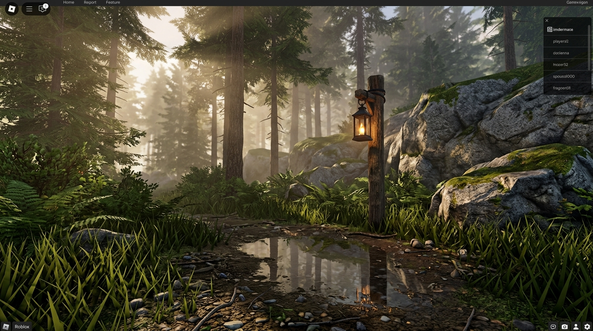
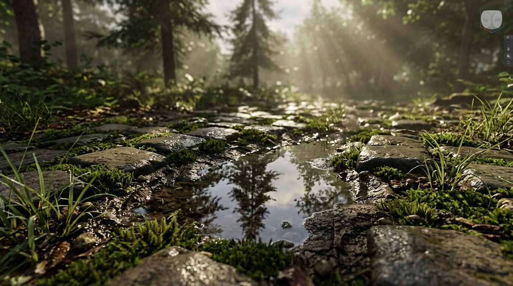
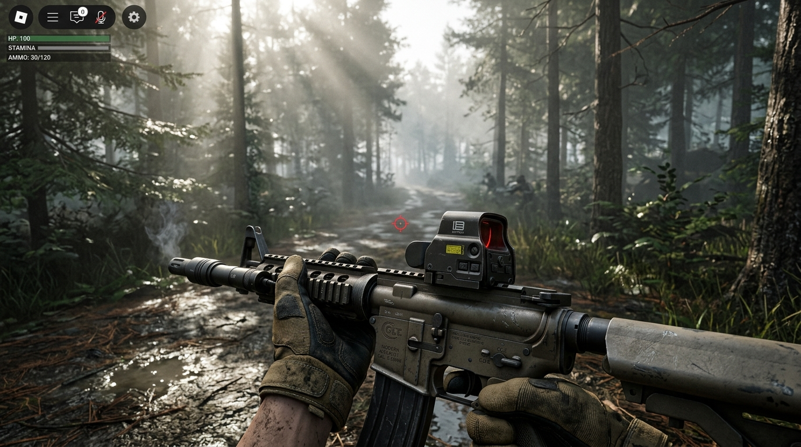
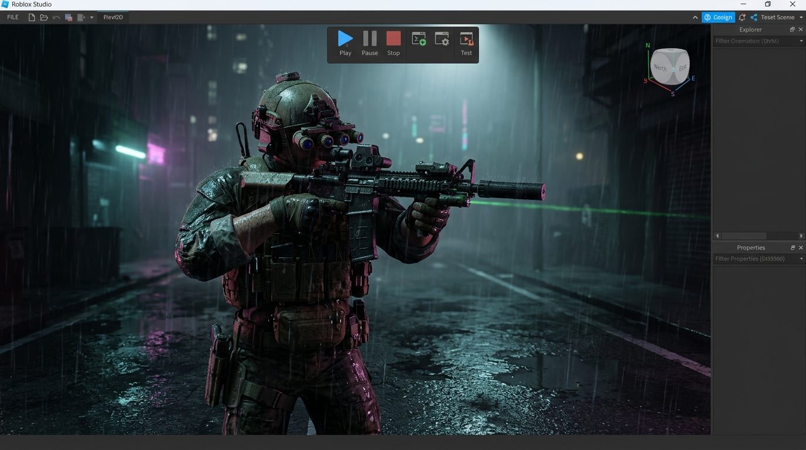

# 🌌 Roblox Hyper-Realism Studio Framework (AAA Engine & AI Skill)
### محرك وسكيل الواقعية الفائقة لروبلوكس — بمستوى Blender و Unreal Engine 5

[](https://opensource.org/licenses/MIT)
[](https://create.roblox.com/)
[](https://create.roblox.com/studio)
[]()

> A revolutionary, all-in-one framework and autonomous AI skill to transform any Roblox game from the classic blocky look into next-generation AAA hyper-realism. Features photorealistic 2K/4K PBR terrain, military ballistics, physical spring recoil, full-body true first person, procedural IK, acoustic occlusion, dynamic weather, and autonomous PC/Studio mouse & keyboard control.

---

## 📸 Visual Showcases (معاينة الجرافيكس من داخل روبلوكس استوديو)

### 1. Forest & Future Lighting (الغابة الألبية وإضاءة المستقبل)


### 2. Macro 4K PBR Ground & Water Reflections (تفاصيل خامات الأرضيات والنتوءات المجهرية)


### 3. Tactical First-Person Combat (التصويب التكتيكي والأسلحة الحربية)


### 4. Night-Ops Rain Scene (المحاكاة التكتيكية الليلية تحت المطر الحجمي)


---

## ⚡ Core Features (الميزات الأساسية)

### 🎨 1. Photorealistic PBR Graphics & Procedural Sculpting
- **Future Lighting & Global Illumination**: Soft multi-source shadows, real-time specular highlights, and ambient light bouncing.
- **Volumetric Atmosphere & Fog**: Rayleigh scattering, dynamic haze, and Godrays piercing through foliage.
- **2K/4K PBR Material Library**: Seamless Color, Normal, and Roughness maps for Alpine Grass, Nordic Rock, Wet Mud, Desert Sand, Cobblestone, and River Pebbles.
- **3D Procedural Sculptor**: Fractal Perlin noise terrain generator for carving mountains, rolling hills, and riverbeds.

### 🔫 2. Hyper-Realistic Combat & Ballistics
- **True Ballistics**: Projectile drop ($g$), muzzle velocity ($v_0$), air drag, and wind deflection (`workspace.GlobalWind`).
- **Physical Spring Recoil**: Procedural camera pitch/yaw and weapon kickback using damped spring physics.
- **Material-Aware Wallbang**: Bullet penetration through glass, wood, sheet metal, and concrete with calibrated damage falloff.
- **Physical Spent Brass Casings**: Rotating ejected casings that bounce on the floor and produce authentic metallic clinking.
- **Supersonic Snap**: Audible bullet crack when rounds whiz past a player's head.

### 🚹 3. Full-Body IK & True First-Person
- **True First-Person**: Players see their actual body, chest rig, legs, feet, and cast accurate shadows.
- **Tactical Leaning (Q / E)**: Torso rotation and camera tilt for peeking corners.
- **Procedural IK Foot Planting**: Two-bone IK adjusts foot height and angle on slopes and boulders.

### 🤖 4. Autonomous AI Hands & Live Streaming Eyes (العيون الحية والبث اللحظي)
- **Live AI Eyes (`scripts/live_ai_eyes.py`)**: Real-time 30-60 FPS in-memory screen perception using `mss` and `numpy` (Zero-disk, 100% RAM buffer, no screenshot files saved).
- **Floating Cyber HUD**: Visual translucent indicator displaying real-time tracking (active window, mouse position, and screen motion).
- **Autonomous Desktop Driver (`scripts/autonomous_pc_driver.py`)**: Allows AI agents to smoothly move the mouse, open applications, focus Roblox Studio, and paste scripts directly into the Command Bar before the user's eyes.
- **Unified Master AI API (`HyperRealismMasterAI.luau`)**: One-line deployment and self-healing diagnostics for any autonomous agent.

---

## 📂 Repository Structure (هيكلية المشروع)

```
├── assets/                          # Showcase screenshots inside Roblox Studio
│   ├── roblox_fps_future_lighting_1792007162103.jpg
│   ├── roblox_future_lighting_showcase_1792006714159.jpg
│   ├── roblox_pbr_macro_showcase_1792007071371.jpg
│   └── roblox_tactical_rain_scene_1792007365297.jpg
│
├── skill/                           # AI Skill Definition
│   └── SKILL.md                     # The autonomous AI skill protocol
│
├── scripts/                         # Automation & Desktop Driver
│   └── autonomous_pc_driver.py      # Python mouse, keyboard & studio controller
│
├── HyperRealismMasterAI.luau         # Unified autonomous AI controller & diagnostics
├── HyperRealismEngine.luau          # Graphics, PBR library & 3D procedural terrain
├── HyperRealisticWeaponsEngine.luau  # Ballistics, spring recoil & surface reactions
├── ProceduralFullBodyIK.luau        # True First Person, Q/E lean & IK foot planting
└── AdvancedTacticalSuite.luau       # Wallbang penetration & brass ejection
```

---

## 🚀 Quick Start (طريقة الاستخدام)

### Option A: One-Click Command Bar (في روبلوكس استوديو)
1. Open your place in **Roblox Studio**.
2. Open the **Command Bar** (`View` > `Command Bar`).
3. Copy and paste the contents of [`HyperRealismEngine.luau`](HyperRealismEngine.luau) and press **Enter**.
4. Enjoy instant AAA graphics, PBR terrain, and Future lighting!

### Option B: Autonomous AI Control (تشغيل الذكاء الاصطناعي الذاتي)
Run the autonomous PC driver via terminal to let the AI operate the mouse and inject the code automatically:
```bash
python scripts/autonomous_pc_driver.py inject_command_bar HyperRealismEngine.luau
```

---

## 📄 License
This project is licensed under the MIT License - see the [LICENSE](LICENSE) file for details.
